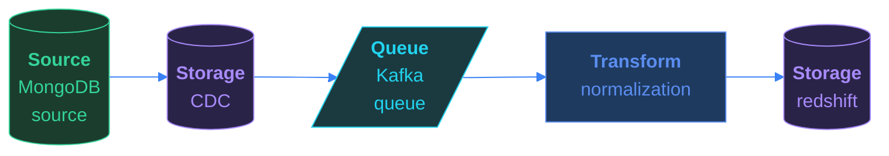

# All at Once

*Two databases. One direction. No data left behind.*

[Pipeline Architecture · Medium · on DataDriven](https://datadriven.io/problems/all_at_once)

## How it went

| | |
|---|---|
| Solved | 2026-10-27 |
| Accepted | on the 2nd submission |
| Hints | none |
| Concepts | Backfill Patterns, Batch Processing, Batch vs Streaming, Change Data Capture, Columnar vs Row Formats, Compression & Encoding, DAG Orchestration, Data Quality & Validation, Deduplication Strategies, Dependency Management, ELT vs ETL, File-Based Ingestion, Full vs Incremental Load, Idempotency, Pipeline Monitoring, Partitioning Strategies, Retry & Failure Handling, Schema Evolution, Small File Problem |

## The design

The whole design, with every component's settings, the connections, the zones and where each sits on the canvas, is in [`architecture.json`](./architecture.json).
